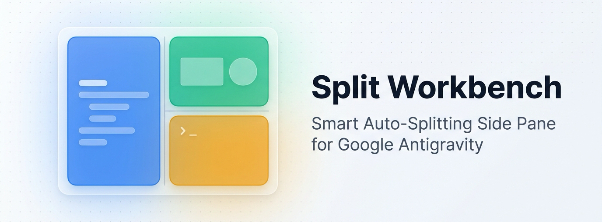
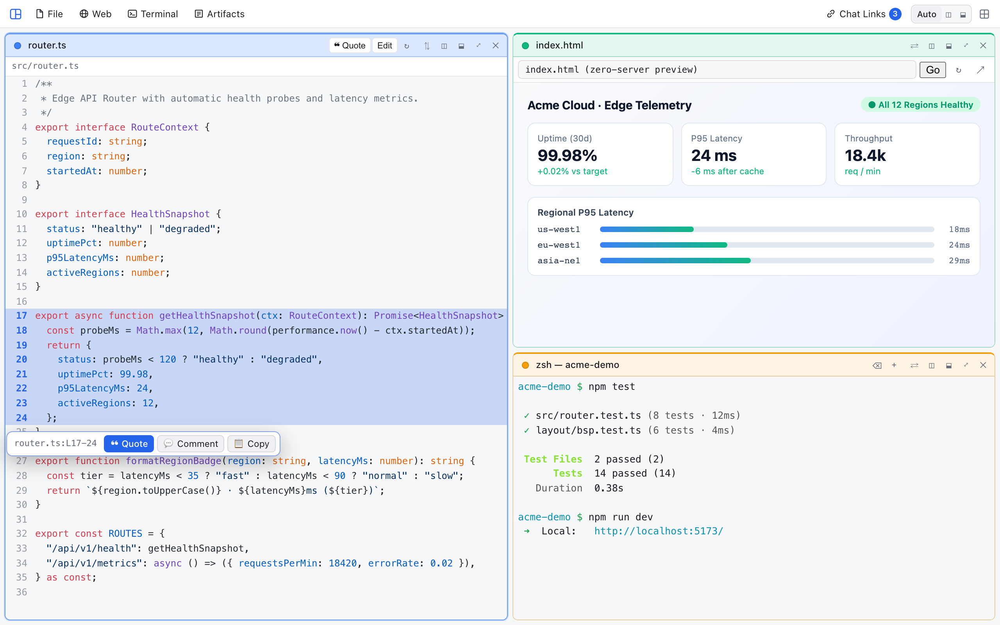
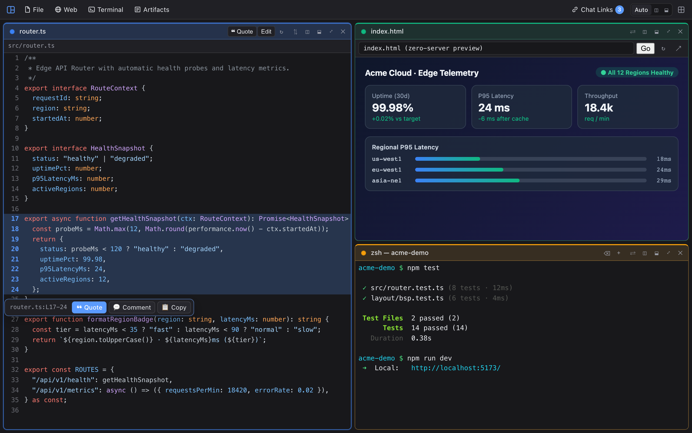

<p align="center">
  <picture>
    <source media="(prefers-color-scheme: dark)" srcset="./assets/banner-dark.png" />
    <source media="(prefers-color-scheme: light)" srcset="./assets/banner-light.png" />
    
  </picture>
</p>

<p align="center">
  <b>English</b> &nbsp;·&nbsp; <a href="./README.zh-CN.md">简体中文</a>
</p>

<p align="center">
  <a href="https://github.com/RZRZ-Q/antigravity-split-workbench/releases/latest">
    
  </a>
  
  = 20" />
  
  
  
  <a href="./LICENSE">
    
  </a>
</p>

<p align="center">
  A smart BSP auto-splitting auxiliary-pane workbench for <b>Google Antigravity App</b> — view multiple workspace files, <code>localhost</code> &amp; zero-server local HTML previews, real interactive PTY terminals, and session artifacts side-by-side or stacked inside one pane.
</p>

<p align="center">
  <picture>
    <source media="(prefers-color-scheme: dark)" srcset="./assets/demo-dark.png" />
    <source media="(prefers-color-scheme: light)" srcset="./assets/demo-light.png" />
    
  </picture>
</p>

<details>
<summary>View both Light &amp; Dark theme previews</summary>

| Light Theme | Dark Theme |
| :---: | :---: |
|  |  |

</details>

---

## Features

- **Smart Auto-Split BSP Layout**: Automatically chooses **horizontal (left/right)** or **vertical (top/bottom)** splits based on the focused pane's aspect ratio (`width > height × 1.1` → horizontal, otherwise vertical), with toolbar overrides for **Auto / Horizontal / Vertical** modes.
- **Per-Pane Split Orientation Toggle**: Click `⇅` / `⇄` on any pane header, press `⌘⇧R`, or right-click any divider gutter to flip that pane group between left/right and top/bottom in place.
- **Zero-Reload Flat Geometry**: Splitting panes, resizing dividers, maximizing, or dragging pane headers to swap positions never reloads embedded `<iframe>` previews or disconnects running PTY terminals.
- **Per-Pane Tab Colors**: Automatically assigns distinct harmonious colors from an 8-color palette to each new split pane; click any pane's color dot to pick a preset, choose a custom hex color, or clear color.
- **4 Built-in Pane Types**:
  - **Files**: Fuzzy workspace file search (`⌘P`) & directory browser, syntax highlighting, Markdown preview/source toggle, image & PDF viewer, live disk auto-reload, optional lightweight inline editing (`⌘S`), and a native-style `⋮` overflow menu (**Copy Content**, **Download File**, **Copy Path**, **In-File Search `⌘F`**, **Reveal in Finder**).
  - **Web Preview**: Back/Forward/Reload history, auto-discovery of listening `localhost` dev ports (`lsof`), quick port input (`5173`), **zero-server local `.html` preview** (HMAC-scoped `/preview/` routes), automatic `X-Frame-Options` / `CSP` detection with inline snapshot fallback, plus a full browser toolbar (**Download HTML**, **Element Inspector & Quote** for local HTML previews, **Headless Screenshot & Quote**, and **Open External**).
  - **Real Interactive Terminal**: Zero-native-build PTY shell powered by Python 3 `pty` + offline-vendored `xterm.js` (256-color, resize-aware, multi-terminal; clicking `http://localhost:...` opens a split Web Preview automatically).
  - **Session Artifacts**: Automatically follows `window.sidecar.conversationId` to browse and live-preview files in `<appData>/brain/<conversationId>/`.
- **Quote & Live Chat Links**:
  - Select text or click / `Shift+Click` line numbers to open a floating **Quote / Comment / Copy** toolbar (`addArtifactComment` + clipboard + `⌘Enter` direct send via `agent.sendMessage`). Terminal selections also support one-click Quote.
  - **Chat Links** watches the current conversation's `transcript.jsonl` to surface files (`#L` line jumps) and URLs mentioned by the agent for one-click split opening.
- **100% Offline Frontend Assets, Auto EN/ZH UI & Native Theme Sync**: `xterm.js`, `marked`, and `highlight.js` are vendored locally; UI automatically matches English or Chinese locale (`?lang=en|zh`) and Antigravity Light/Dark themes.

---

## Installation

### Option 1: Antigravity App (Recommended)

Clone directly into your global Antigravity plugins directory:

```bash
git clone https://github.com/RZRZ-Q/antigravity-split-workbench.git ~/.gemini/config/plugins/split-workbench
```

Antigravity automatically discovers and starts the plugin without restarting the app:
1. Verify **Split Workbench** is enabled under **Customizations → Installed**.
2. Click **`+`** in the right-hand auxiliary pane header and choose **Split**.

### Option 2: Antigravity CLI (`agy`)

```bash
agy plugin install https://github.com/RZRZ-Q/antigravity-split-workbench
```

### Option 3: Local Development Symlink

```bash
git clone https://github.com/RZRZ-Q/antigravity-split-workbench.git
ln -s "$(pwd)/antigravity-split-workbench" ~/.gemini/config/plugins/split-workbench
```

---

## Keyboard Shortcuts

| Shortcut | Action |
| :--- | :--- |
| `⌘P` / `Ctrl+P` | Quick-open workspace file (auto-splits) |
| `⌘F` / `Ctrl+F` | In-file search inside the active File / Artifact pane |
| `⌘⇧R` / `Ctrl+Shift+R` | Toggle active pane's split between left/right and top/bottom |
| `⌘⇧\` / `Ctrl+Shift+\` | Split right (new empty pane) |
| `⌘⇧-` / `Ctrl+Shift+-` | Split down (new empty pane) |
| `⌘⇧Enter` | Maximize / restore active pane |
| Click / `Shift+Click` line number | Select line(s) and open floating Quote bar |
| Double-click gutter | Reset split ratio to 50/50 |
| Right-click gutter | Flip that split between horizontal and vertical |

---

## Web Preview Compatibility

Because Antigravity sidecar UIs render inside standard webviews, the Web Preview pane embeds pages via `<iframe>`:

- **Always supported (100% interactive)**:
  - **Local dev servers**: `localhost:5173` (Vite), `3000` (Next.js/React), `8000/docs` (FastAPI Swagger), `8501` (Streamlit), `7860` (Gradio), etc. — just type the port number.
  - **Zero-server local `.html` files**: Paste a local `.html` path into the URL bar or click **🌐 Preview** on any `.html` file pane.
  - **Embeddable developer docs & tools** *(verified)*:
    - Docs: [Python](https://docs.python.org/3/), [Node.js API](https://nodejs.org/docs/latest/api/), [TypeScript](https://www.typescriptlang.org/docs/), [React](https://react.dev/), [Tailwind CSS](https://tailwindcss.com/docs), [Vite](https://vite.dev/), [Wikipedia](https://en.wikipedia.org/wiki/Main_Page)
    - Interactive tools: [Excalidraw](https://excalidraw.com/), [Mermaid Live](https://mermaid.live/), [JSON Crack](https://jsoncrack.com/), [httpbin](https://httpbin.org/)
- **Sites that block iframe embedding (`X-Frame-Options` / `CSP: frame-ancestors`)**:
  - Account-protected or strict anti-clickjacking sites (e.g. Google, GitHub, MDN, arXiv) disallow iframe embedding by design. Split Workbench automatically detects these headers and offers one-click **Open in Browser** or **View Snapshot Here** (renders a live headless screenshot right inside the split pane for side-by-side reference).

---

## Requirements & Architecture

- **Runtime**: Node.js >= 20, Python 3 (built-in `pty` module; macOS / Linux).
- **Security**: Binds strictly to `127.0.0.1`, enforces `X-Sidecar-Token` on API & PTY endpoints, restricts filesystem access to user home/temp paths, and scopes local HTML previews with per-directory HMAC signatures.

### Run Tests & Standalone Debug

```bash
# Run layout unit tests + live HTTP / Auth / FS / PTY SSE / screenshot smoke tests
node test/smoke.mjs

# Standalone local browser preview
ANTIGRAVITY_SIDECAR_WEB_PORT=49188 node sidecars/workbench/main.mjs
# Open http://127.0.0.1:49188/?workspace=/path/to/your/project
```

## License

[MIT](./LICENSE)
