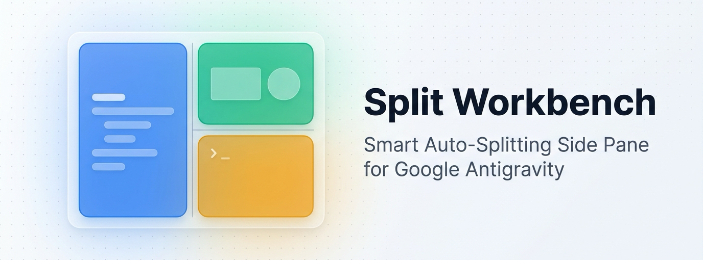
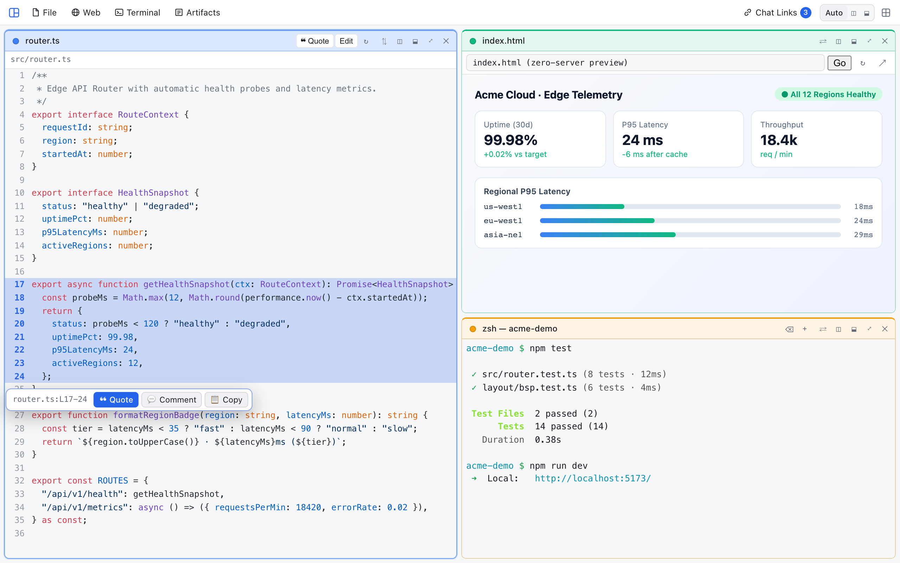
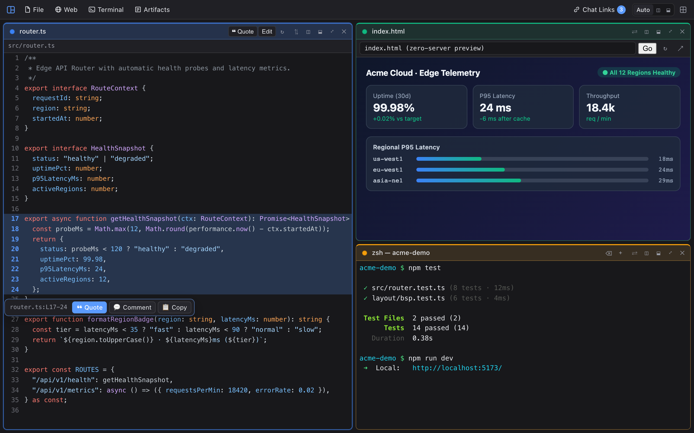

<p align="center">
  <picture>
    <source media="(prefers-color-scheme: dark)" srcset="./assets/banner-dark.png" />
    <source media="(prefers-color-scheme: light)" srcset="./assets/banner-light.png" />
    
  </picture>
</p>

<p align="center">
  <a href="./README.md">English</a> &nbsp;·&nbsp; <b>简体中文</b>
</p>

<p align="center">
  <a href="https://github.com/RZRZ-Q/antigravity-split-workbench/releases/latest">
    
  </a>
  
  = 20" />
  
  
  
  <a href="./LICENSE">
    
  </a>
</p>

<p align="center">
  专为 <b>Google Antigravity App</b> 打造的智能 BSP 自动分屏工作台插件 —— 在右侧辅助面板中同时并排或上下查看多个代码文件、<code>localhost</code> 与免起服务本地 HTML 网页预览、真实交互式 PTY 终端及当前会话产物（Artifacts）。
</p>

<p align="center">
  <picture>
    <source media="(prefers-color-scheme: dark)" srcset="./assets/demo-dark.png" />
    <source media="(prefers-color-scheme: light)" srcset="./assets/demo-light.png" />
    
  </picture>
</p>

<details>
<summary>展开同时对比浅色与暗黑主题效果</summary>

| 浅色主题（Light） | 暗黑主题（Dark） |
| :---: | :---: |
|  |  |

</details>

---

## 核心特性

- **智能 BSP 自动分屏**：新开面板时自动测算当前聚焦格子的宽高比——`宽 > 高 × 1.1` 自动**左右分屏**，否则自动**上下分屏**；顶栏支持随时切换 **自动 / 左右 / 上下** 模式。
- **单窗口自由切换横 / 竖分屏**：点击任意窗口标题栏的 `⇅` / `⇄`、按快捷键 `⌘⇧R`，或右键任意分隔线，即可原地翻转该组窗口的上下 / 左右布局。
- **零重载扁平几何布局**：分屏、拖拽分隔线调比例、单格最大化，或按住标题栏拖拽互换两个窗口位置时，已打开的网页 `<iframe>` 不会刷新、运行中的终端不会断开。
- **分屏窗口 Tab 颜色**：内置 8 色和谐色板，每新拆一个窗口自动分配与相邻格不同的颜色；点击标题栏最左侧彩色圆点可一键换色、自定义任意十六进制色或设为无色。
- **4 种内置面板**：
  - **📄 文件（Files）**：工作区模糊搜索（`⌘P`）与目录浏览、多语言代码高亮、Markdown 渲染 / 源码切换、图片与 PDF 预览、文件保存自动热刷新、可选轻量直接编辑（`⌘S`），并集成原生同款 `⋮` 菜单（**复制全文**、**下载文件**、**复制路径**、**页内搜索 `⌘F`**、**在访达中显示**）。
  - **🌐 网页预览（Web）**：带 **后退 / 前进 / 刷新** 历史栈、自动发现本机监听中的 `localhost` 开发端口（`lsof`）、快捷输端口号（如 `5173`）、**免起服务本地 `.html` 预览**（HMAC 作用域 `/preview/` 静态托管）、自动识别 `X-Frame-Options` / `CSP` 并提供一键快照兜底；右侧集成完整工具栏（**下载页面 HTML**、本地 HTML **点选元素 Quote**、**Headless 网页截图并 Quote**、**外部浏览器打开**）。
  - **💻 真实交互终端（Terminal）**：基于 Python 3 内置 `pty` + 离线内置 `xterm.js`，零 C++ 原生编译依赖，256 色真终端，随分屏拖拽自适应行列尺寸；点击终端中输出的 `http://localhost:...` 链接会自动新开网页分屏预览。
  - **📑 会话产物（Artifacts）**：自动绑定当前对话的 `window.sidecar.conversationId`，实时列出并渲染 `<appData>/brain/<conversationId>/` 目录下的文档与图片产物。
- **划词 / 点行号 Quote & 对话链接实时捕获**：
  - 在文件 / Markdown / Artifact 中划选文本，或点击 / `Shift+点击` 左侧行号，立即弹出悬浮 **❝ Quote / 💬 提问 / 📋 复制** 工具条（支持 `addArtifactComment` 挂到下条消息、复制到剪贴板，以及 `⌘Enter` 直接发送给 Agent）；终端划选日志同样支持一键 Quote。
  - **对话链接（Chat Links）** 实时解析当前对话 `transcript.jsonl`，汇总 Agent 提及的 `file://` 文件（支持 `#L` 行号定位）与网址，一键自动分屏打开。
- **100% 离线前端资源 & 中英双语主题自适应**：`xterm.js`、`marked`、`highlight.js` 全部内置离线运行，自动跟随系统语言（支持 `?lang=en|zh`）与 Antigravity 亮/暗主题。

---

## 安装方式

### 方式 1：Antigravity App（推荐）

直接克隆到全局插件目录即可自动发现并启动，**无需重启 App**：

```bash
git clone https://github.com/RZRZ-Q/antigravity-split-workbench.git ~/.gemini/config/plugins/split-workbench
```

1. 在左侧栏 **Customizations → Installed** 确认 **Split Workbench** 已开启；
2. 点击右侧辅助栏顶部 **`+`** 菜单选择 **Split** 打开。

### 方式 2：Antigravity CLI（`agy`）

```bash
agy plugin install https://github.com/RZRZ-Q/antigravity-split-workbench
```

### 方式 3：本地开发软链模式

```bash
git clone https://github.com/RZRZ-Q/antigravity-split-workbench.git
ln -s "$(pwd)/antigravity-split-workbench" ~/.gemini/config/plugins/split-workbench
```

---

## 快捷键一览

| 快捷键 | 功能 |
| :--- | :--- |
| `⌘P` / `Ctrl+P` | 快速搜索打开工作区文件（自动分屏） |
| `⌘F` / `Ctrl+F` | 在当前文件 / Artifact 面板内搜索 |
| `⌘⇧R` / `Ctrl+Shift+R` | 切换当前聚焦窗口的左右 / 上下分屏方向 |
| `⌘⇧\` / `Ctrl+Shift+\` | 向右新拆一个窗口 |
| `⌘⇧-` / `Ctrl+Shift+-` | 向下新拆一个窗口 |
| `⌘⇧Enter` | 最大化 / 还原当前窗口 |
| 点击 / `Shift+点击` 行号 | 选中单行或多行并弹出 Quote 工具条 |
| 双击分隔线 | 恢复 50/50 均等分屏 |
| 右键分隔线 | 在上下 / 左右分屏之间翻转该组 |

---

## 网页预览兼容性

Antigravity 插件面板运行在标准 Webview 的 `<iframe>` 中，兼容性说明如下：

- **100% 原生支持并可完整交互**：
  - **本机开发服务**：`localhost:5173`（Vite）、`3000`（Next/React）、`8000/docs`（FastAPI Swagger）、`8501`（Streamlit）、`7860`（Gradio）等，直接输入端口号即可。
  - **免起服务本地 `.html` 文件**：将本地 `.html` 路径粘进地址栏，或在文件面板右上角点 **🌐 预览**。
  - **常见可直接内嵌的技术文档与开发工具**（已实测）：
    - 技术文档：[Python](https://docs.python.org/3/)、[Node.js API](https://nodejs.org/docs/latest/api/)、[TypeScript](https://www.typescriptlang.org/docs/)、[React](https://react.dev/)、[Tailwind CSS](https://tailwindcss.com/docs)、[Vite](https://vite.dev/)、[Wikipedia](https://en.wikipedia.org/wiki/Main_Page)
    - 在线工具：[Excalidraw 白板](https://excalidraw.com/)、[Mermaid Live](https://mermaid.live/)、[JSON Crack](https://jsoncrack.com/)、[httpbin](https://httpbin.org/)
- **禁止 iframe 内嵌的外部站点（`X-Frame-Options` / `CSP: frame-ancestors`）**：
  - 带账号登录态或严格防点击劫持的站点（如 Google、GitHub、飞书、MDN、arXiv）默认禁止 iframe 嵌入。工作台会自动检测响应头并展示友好提示卡片，支持一键 **「↗ 系统浏览器打开」** 或 **「📷 截取快照在此查看」**（在当前格子里直接渲染页面快照对照写代码）。

---

## 运行环境与安全说明

- **运行依赖**：Node.js >= 20、Python 3（使用标准库 `pty`，支持 macOS / Linux）。
- **安全机制**：仅监听本机回环 `127.0.0.1`；所有 API 与终端流校验 `X-Sidecar-Token`；文件访问限定在用户目录与临时目录内；本地 HTML 预览使用目录级 HMAC 签名路径，不依赖第三方 Cookie。

### 运行测试与本地独立调试

```bash
# 运行布局单元测试 + HTTP / 鉴权 / 文件 / PTY SSE / 网页截图集成测试
node test/smoke.mjs

# 脱离 Antigravity 在浏览器独立预览调试
ANTIGRAVITY_SIDECAR_WEB_PORT=49188 node sidecars/workbench/main.mjs
# 浏览器打开 http://127.0.0.1:49188/?workspace=/path/to/your/project
```

## 开源协议

[MIT](./LICENSE)
